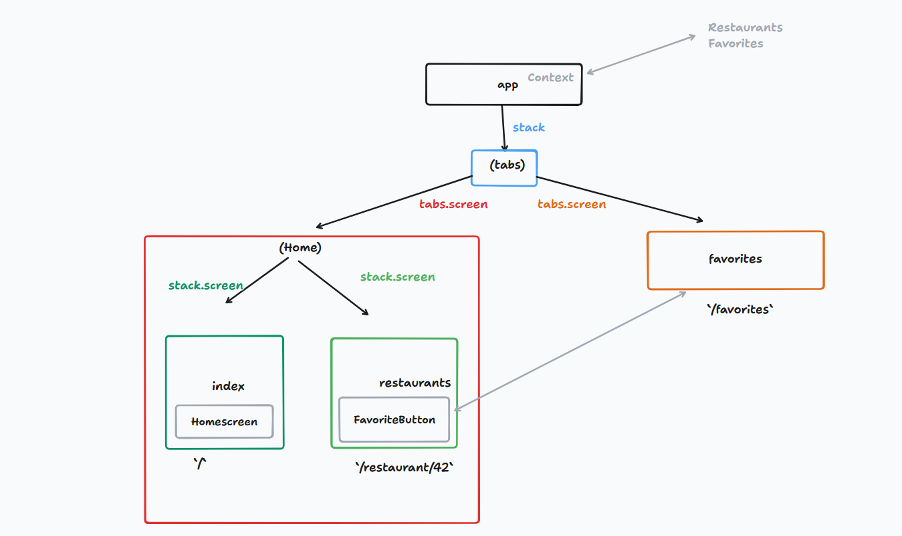

# Correction J3 – Router

## Préambule

En définissant nos besoins en terme d'écrans, il parait judicieux
de gérer les favoris dans un contexte.

Cela permettra de partager une seule source de vérité dans toute notre application.

### Contexte : Favoris

1. création : on gère nos favoris dans un tableau d'ID

2. _Provider_ :
   - je stocke mes favoris dans un état
   - je récupère mes favoris depuis le LocalStorage

3. _hook_ personnalisé pour garantir la non-nullité des favoris

4. diffusion du contexte
